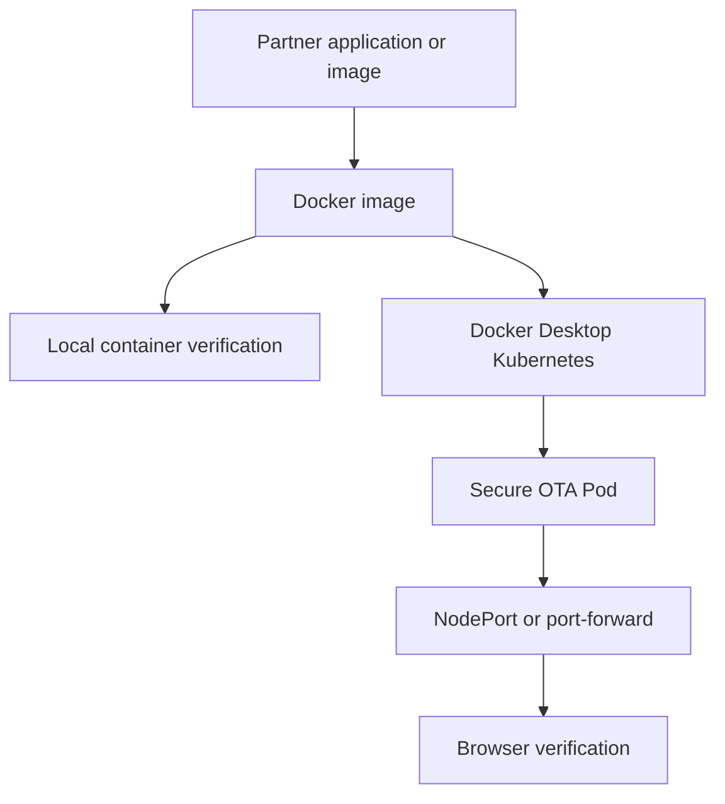

# Secure OTA Deployment Lab

A Docker and Kubernetes delivery case study for a browser-based Secure OTA Hash Validator. The work demonstrates how I received another developer's application, preserved its behavior, packaged it, transferred container images, and deployed it locally with health and security controls.

## Attribution and ownership

The original **Secure OTA Hash Validator application was created by Somers Matthews**:

https://github.com/somersbmatthews/secure-ota-hash-validator

Somers owns the application source and its original functionality. This repository intentionally does **not** republish that source. My work covers the delivery layer: Docker packaging, image transfer, Kubernetes configuration, verification, and documentation.

## My contribution

- Added an NGINX Docker delivery configuration for the exchanged source folder
- Built and verified a versioned Docker image
- Mapped host traffic to the container web service
- Exported and imported Docker images for partner delivery
- Loaded the received image into Docker Desktop Kubernetes
- Created a Kubernetes Deployment and NodePort Service
- Added liveness and readiness probes
- Applied a non-root, read-only security posture with dropped Linux capabilities
- Set CPU and memory requests and limits
- Verified the application through local Docker and Kubernetes endpoints

## Delivery architecture

## Repository contents

| Path | Purpose |
|---|---|
| `docker/Dockerfile` | Packages the exchanged static website with NGINX |
| `docs/DOCKER_DELIVERY.md` | Build, run, verify, export, and import workflow |
| `docs/IMAGE_TRANSFER.md` | Partner-image transfer and Kubernetes image-loading notes |
| `k8s/secure-ota-k8s.yaml` | Hardened Kubernetes Deployment and Service |

## Docker delivery demonstration

Video: https://youtu.be/mkn4LNzlBag

The source-folder workflow serves the application on container port 80 and maps it to `localhost:8081`.

## Kubernetes delivery demonstration

Video: https://youtu.be/f0n-s52Bc1k

The received partner image listens on container port 8080. The Kubernetes manifest exposes the service with NodePort `30080`, while port-forwarding can provide `localhost:8082` during verification.

## Why the port numbers differ

These demonstrations used two delivery artifacts:

1. The Docker assignment added `docker/Dockerfile` to the exchanged source and served it with NGINX on port 80.
2. The Kubernetes assignment used the partner's prebuilt image, which exposed its web service on port 8080.

Keeping those paths separate documents what was actually delivered and avoids changing the partner's application.

## Security controls

The Kubernetes workload denies privilege escalation, runs without root, uses a read-only root filesystem, drops all Linux capabilities, and mounts only the temporary paths required at runtime. Health probes verify that Kubernetes sends traffic only to a responsive application.

## Professional takeaway

This lab demonstrates software-delivery skills beyond writing application code: receiving an unfamiliar artifact, identifying its runtime contract, packaging it consistently, troubleshooting image availability, applying container security controls, and proving that the deployed service works.
